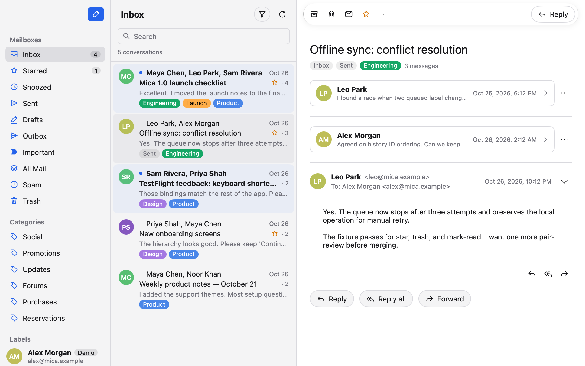

<p align="center">
  
</p>

<h1 align="center">Mica</h1>

<p align="center">
  <strong>A focused, native Gmail client for macOS.</strong><br>
  Read, organize, and reply to mail in a quiet three-pane workspace.
</p>

<p align="center">
  <a href="https://github.com/everpcpc/mica/actions/workflows/ci.yml"></a>
  <a href="https://github.com/everpcpc/mica/releases/latest"></a>
  <a href="go.mod"></a>
  
</p>

<p align="center">
  <picture>
    <source media="(prefers-color-scheme: dark)" srcset="docs/screenshots/readme-dark.png">
    
  </picture>
</p>

## Features

- **A calm three-pane workflow.** Navigate mailboxes, categories, and labels while keeping the current conversation in focus.
- **Built for inbox processing.** Search Gmail, filter unread conversations, and use Gmail-style keyboard shortcuts.
- **Fast local actions with undo.** Archive, star, trash, report spam, and change read state immediately while changes synchronize in the background.
- **Compose and reply.** Write new mail, reply, reply all, forward, and open or save attachments.
- **Persistent Outbox.** Sends are journaled locally with attachments and a stable Message-ID. Review, retry, or delete outgoing mail; retries check Sent and require confirmation before sending again.
- **Email links.** Open `mailto:` links into a draft, with an explicit default email app setting in macOS.
- **Label management.** Assign, create, recolor, and delete custom Gmail labels.
- **Comfortable reading.** Sanitized HTML mail, inline images, collapsible messages, light and dark appearances, and reduced-motion support.
- **Remote image privacy.** Remote images are blocked by default. Allow them for one message or enable automatic loading in Settings.
- **Multiple Gmail accounts.** Add, switch between, reauthorize, and remove accounts without mixing their credentials, caches, drafts, or notifications.
- **All Inboxes.** Merge multiple Gmail inboxes with independent per-account pagination, owner-aware reading, replies, drafts, and actions, or expand the account group to open one account's Inbox.
- **Offline access and notifications.** A local SQLite cache keeps loaded mail available offline, while Gmail watch and history synchronization keep it current.
- **English and Simplified Chinese.** Follow the system language or choose one in Settings.
- **A complete demo mailbox.** Explore the workflow without connecting a Google account.

## Installation

Download the latest universal DMG from [GitHub Releases](https://github.com/everpcpc/mica/releases/latest), open it, and drag Mica to Applications. The universal build supports both Apple Silicon and Intel Macs.

On first launch, Mica opens the interactive demo mailbox. Open **Settings** with <kbd>⌘</kbd><kbd>,</kbd> to connect Gmail, change the appearance, or choose a language.

## Building from source

### Prerequisites

- macOS
- Go 1.27.2 or newer
- A Google Cloud project with the Gmail API and Cloud Pub/Sub API enabled

Clone the repository:

```sh
git clone https://github.com/everpcpc/mica.git
cd mica
```

Mica embeds an OAuth Desktop client at build time. Create one in [Google Cloud Credentials](https://console.cloud.google.com/apis/credentials), download its JSON, and save it as:

```text
internal/gmail/oauth-client.json
```

The file's `installed` object must include `client_id` and `client_secret`. Include `project_id` for push notifications. This configuration is required for every build, including demo-only development, and is ignored by Git so credentials are not committed.

Start the development app with live reload:

```sh
go tool mygo dev
```

Build a universal production app and DMG:

```sh
go tool mygo build -platform darwin/universal
```

Build artifacts are written to `build/darwin-universal/`. Local builds are ad-hoc signed by default; the release workflow handles signing, notarization, and publication.

## Development

Mica is written in Go using [MyGo](https://github.com/egoist/mygo) native UI. The application structure, UI conventions, caching behavior, and synchronization model are documented in [docs/design.md](docs/design.md).

Run the project checks before submitting a change:

```sh
go tool mygo generate
go tool mygo i18n check .
CGO_ENABLED=0 go test ./...
go test -race ./...
go vet ./...
go tool mygo vet .
git diff --check
```

Tests use fake services or the demo mailbox. Never run destructive tests against a real Gmail account.

## Privacy and security

- OAuth tokens are stored in the macOS Keychain.
- Account metadata, labels, and loaded conversations are cached locally in SQLite. Attachment binaries and remote images remain on demand.
- HTML mail is sanitized and rendered in per-message sandboxed WebViews. Remote image requests never carry Gmail credentials.

## Contributing

Bug reports and focused pull requests are welcome. Please read the [design notes](docs/design.md) and [development lessons](docs/LESSONS.md) before making changes, add regression tests for fixes, and run the checks above.

See [CHANGELOG.md](CHANGELOG.md) for the release history.
